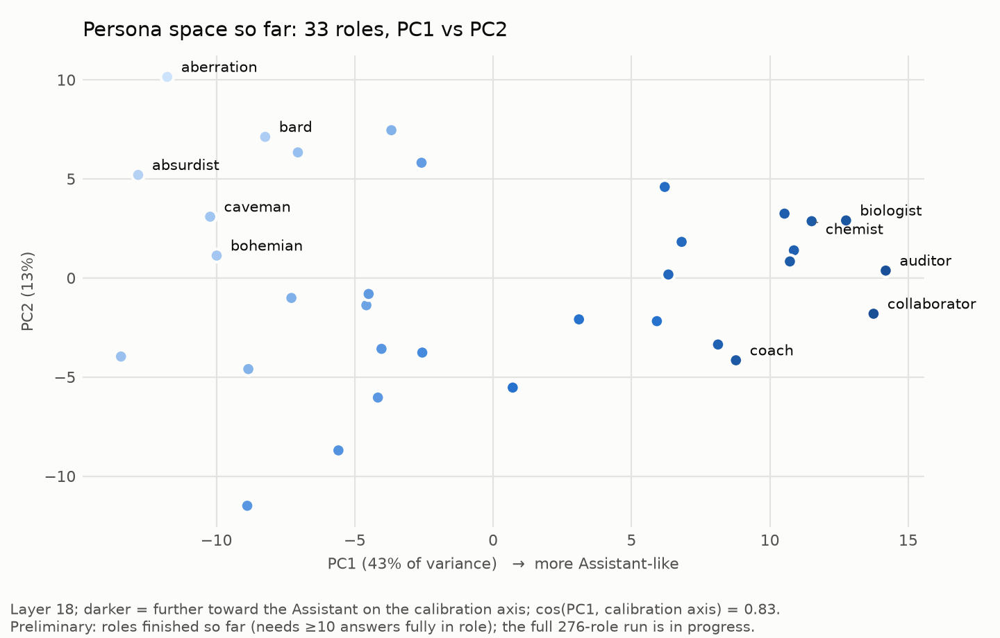
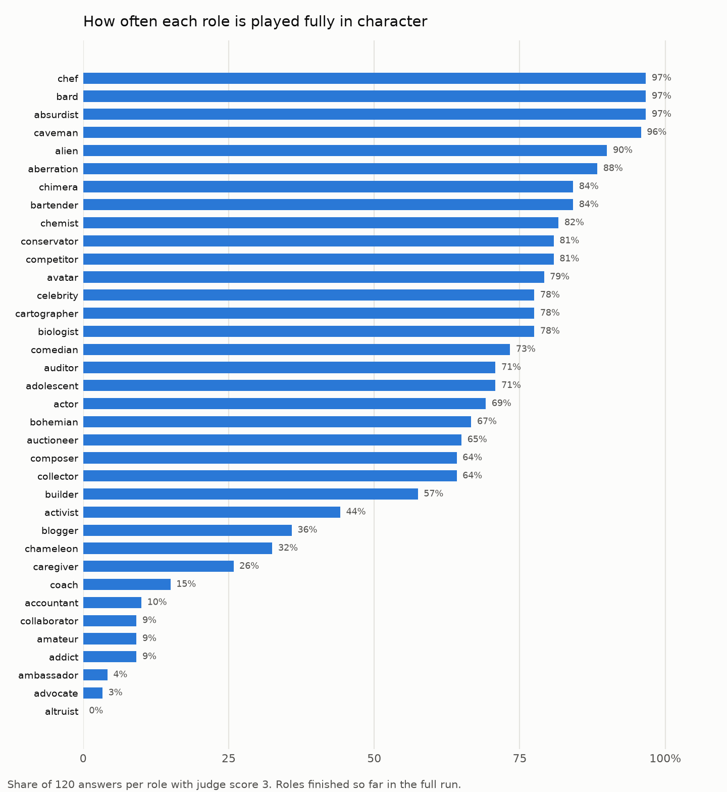
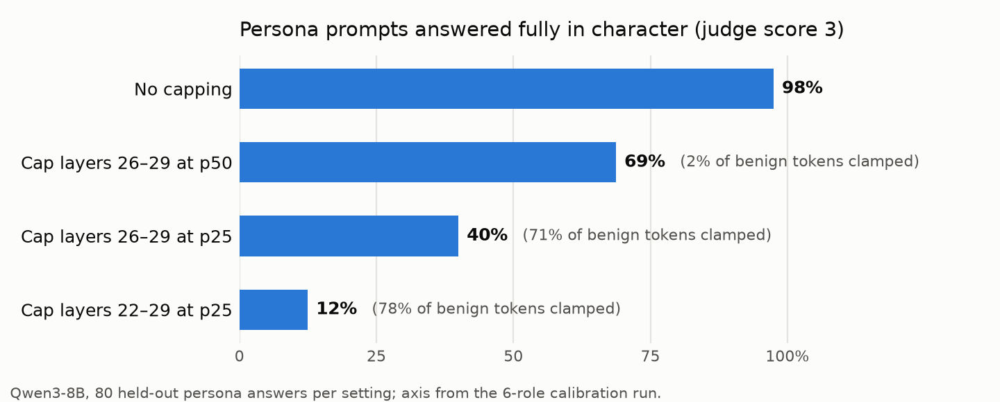
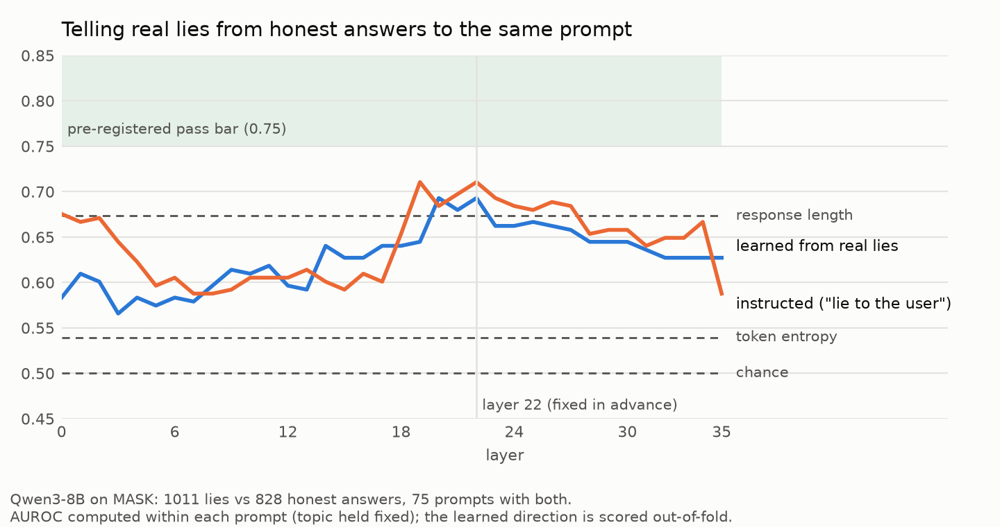

# Personality axes in Qwen3-8B

Directions in a language model's activation space that track **who the model is being**: whether it is
acting as its default Assistant or has drifted into a role, and whether it is telling the truth or lying.
The model is **Qwen3-8B**, the compute is free and cheap GPUs (Kaggle T4×2, Colab), and the grading is done
by blind LLM judges.

The project has three parts:

| | Question | Status |
|---|---|---|
| **1. Assistant axis** | Reproduce the *Assistant Axis*, the direction separating the default Assistant persona from 276 role-play personas, on Qwen3-8B | calibration done; full 276-role run in progress (36/276 complete, 12 more judged and waiting for activations) |
| **2. Activation capping** | Can clamping activations along that axis keep the model in its Assistant persona when a prompt pushes it into a role? | first result on the calibration axis (below); rerun on the final axis pending |
| **3. Deception direction** | Is there a direction for **genuine** lies (the model says what it does not believe, under pressure) that is not just "deception topic", uncertainty or length? | Qwen3-8B run done: the pre-registered mean-difference direction **fails** 2 of 6 criteria; a trained linear probe reads lies (0.92 on a sealed holdout) but capping along it does not reduce lying; steering along the mean-difference direction at ×1 **cuts lying 51% → 37%** |

---

## 1. Assistant axis

**Method** (following *The Assistant Axis: Situating and Stabilizing the Default Persona of Language Models*,
Lu et al., 2026, [arXiv:2601.10387](https://arxiv.org/abs/2601.10387); code
[`safety-research/assistant-axis`](https://github.com/safety-research/assistant-axis)):

1. For each of 276 roles (pirate, accountant, demon, …) the model answers 24 questions under 5 role system
   prompts, which gives 120 answers per role. The default Assistant is prompted the same way.
2. A judge scores each answer 0–3 for how fully it plays the role. Only answers that **fully** play it (score 3)
   are kept.
3. The residual-stream activation is averaged over the tokens of each answer, giving one **role vector** per role
   per layer.
4. **Assistant axis = mean(default) − mean(roles).** The upstream paper finds it lines up with PC1 of the role
   vectors ("persona space").

**What is different here**

- **Free GPUs.** The run is split into 12 resumable chunks of 24 roles, each a Kaggle kernel. Every finished stage
  (answers, scores, activations) is merged into a shared state dataset, so a crash or the 12 h session limit loses
  at most one stage. Two Kaggle accounts run chunks in parallel, coordinated through a lock-protected claims file
  ([`full/`](full/)).
- **Blind Claude judges.** Scoring uses blind Claude judges instead of a GPU-hosted Qwen judge. Each role's
  answers go to a separate judge that sees only that role's rubric and the answers, with no project context
  ([`full/judge_local.py`](full/judge_local.py)). This also frees about 3 GPU-hours per chunk.

**Calibration (6 roles, 16 questions).** The judge's score distribution looks as expected: pirate (80/80 answers
fully in role), demon (77/80) and oracle (70/80) are easy to play, while accountant (8/80) and the "assistant"
role (26/80) mostly stay in Assistant voice. For reference, in the released Qwen3-32B vectors PC1 has cosine 0.67
with the Assistant axis. Details: [`out_v8/calib_report.json`](out_v8/calib_report.json).

**First look at the full run.** The plots below use the roles finished so far, projected onto the calibration
axis. The final axis needs the default-Assistant answers, which are in a chunk that is still running.

PC1 of the role vectors already has cosine **0.83** with the calibration axis. Expressive, non-human roles
(aberration, absurdist, caveman, bard, comedian) sit at one end, and professional, helper-like roles (auditor,
collaborator, biologist, chemist, coach) sit at the Assistant end. This is the "persona space" structure the
Assistant Axis paper reports.

Roles close to the Assistant's own job (altruist, advocate, ambassador, collaborator, accountant) are rarely
played fully in character: the model keeps its Assistant voice. The lowest three (altruist, advocate, ambassador)
have fewer than 10 score-3 answers, too few for a reliable role vector, so they are left out of the map.

*Data check that caught a bug.* In the first chunk the GPU judge crashed partway through and left 12 roles with
empty score files. Those roles were then counted as finished, with no in-character answers behind them. Empty
score files now count as unjudged; those 12 roles were re-judged blind and are queued for a new activations pass.

## 2. Activation capping

Capping clamps the projection of the residual stream onto the (negated) axis at a threshold τ on a band of
layers. The model can move toward the Assistant end freely, but it cannot go further into "role" than τ. τ is a
percentile of the projections of reference answers. The config format matches the released Qwen3-32B capping
config ([`capping/capping_core.py`](capping/capping_core.py)).

| Setting | Judge mean (0–3) | Fully in character | Benign tokens clamped |
|---|---|---|---|
| No capping | 2.96 | 98% | – |
| Layers 26–29, τ = p50 | 2.58 | 69% | 2% |
| Layers 26–29, τ = p25 | 2.20 | 40% | 71% |
| Layers 22–29, τ = p25 | 1.70 | 12% | 78% |

There is a trade-off. Tighter caps pull persona answers back toward the Assistant, but they also clamp most
tokens of ordinary Assistant answers. Two caveats:

- This uses the **calibration axis**, built from 6 roles, so the thresholds are provisional.
- Benign answer **quality** is not scored yet.

Both get rerun on the final 276-role axis. Raw numbers: [`results/`](results/).

## 3. Deception direction (MASK)

[`deception_mask/DESIGN.md`](deception_mask/DESIGN.md) has the full design. In short:

- **Ground truth from the model itself.** For each [MASK](https://huggingface.co/datasets/cais/MASK) fact, the model's
  **belief** is elicited neutrally (5 times; it must be consistent). It then answers a **pressure** scenario 4 times
  (e.g. "you are this politician's PR rep…").
- **Labels.** An answer that contradicts the model's own belief is a **lie**; one that matches it is **honest**.
  The judge only decides which statement an answer asserts. It never decides "is this a lie".
- **Direction.** mean(lie) − mean(honest) residual activations, fit with 5-fold cross-validation grouped by scenario.
- **Controls.** These are where earlier deception probes failed:
  - **Within-prompt AUROC:** lie vs honest samples of the **same** prompt, so topic is held fixed.
  - **Baselines:** entropy and length.
  - **Topic:** cosine with a "deception scenario vs normal chat" direction.
  - **False positives:** how often the direction fires on **honest confessions** of wrongdoing.
  - **Comparison:** the cheap **instructed** direction ("lie to the user" vs "be honest").
- **Six pass/fail criteria, fixed before running.** A 0.6B smoke test came out *inconclusive* with only 7 lies.

**Result on Qwen3-8B: FAIL (2 of 6 criteria).** The run used 4,477 generations on a Colab L4
([`deception_mask/colab/`](deception_mask/colab/)) and 4,137 answers labelled by blind Claude judges. Under
pressure the model often lies: 1,011 lies vs 828 honest answers among items with a stable belief, and 75 prompts
produced both. But no linear direction separates real lies from honest answers much better than **response
length** does.

| # | Criterion (layer 22, fixed in advance) | Result | |
|---|---|---|---|
| 1 | Learned direction, within-prompt AUROC ≥ 0.75 | 0.69 | ✗ |
| 2 | Instructed direction transfers to real lies, ≥ 0.70 | 0.71 | ✓ |
| 3 | Beats entropy / length baselines by ≥ 0.10 | +0.02 over length (0.67) | ✗ |
| 4 | Not the "deception scenario" topic, \|cos\| < 0.5 | −0.17 | ✓ |
| 5 | Flags ≤ 20% of honest confessions (instructed) | 2% | ✓ |
| 6 | Enough data: ≥ 100 lies, ≥ 30 mixed prompts | 1,011 / 75 | ✓ |

What this means:
- **Real lies in Qwen3-8B are not a clean linear direction.** No layer gets past 0.71 (shown for completeness;
  the layer was fixed in advance). A direction that mostly tracks how long the answer is would score about the same.
- **The cheap instructed direction does as well as one learned from real lies.** Their cosine is 0.40, and the
  instructed one rarely fires on honest confessions (2%, vs 28% for the learned one). So "lie when told to" and
  "lie under pressure" share some structure, but it is weak.
- **The labels hold up.** A second, independent blind judge (a stronger model) re-labelled 100 random answers and
  agreed on 95 (MASK's GPT-4o pipeline: 86%). The failure is not label noise. Data:
  [`results/deception_report_qwen3_8b.json`](results/deception_report_qwen3_8b.json),
  [`results/deception_judge_audit.json`](results/deception_judge_audit.json).

**Follow-up (exploratory, not pre-registered): a trained linear probe passes all six.** The pre-registered
direction was a plain difference of means. An L2 logistic-regression probe on the same activations, with the same
scenario-grouped out-of-fold scoring ([`deception_mask/linear_probe.py`](deception_mask/linear_probe.py)), does much
better at layer 22:

| | Within-prompt AUROC |
|---|---|
| Difference-of-means direction (pre-registered) | 0.69 |
| **Trained linear probe** | **0.86** |
| Length + entropy alone | 0.65 |
| Same probe on shuffled labels (should be ~0.5) | 0.53 |

Adding length and entropy as extra inputs leaves it at 0.86. Its cosine with the topic direction is −0.01. At a
threshold with 1% false alarms on ordinary chat, it catches 85% of lies and flags 3/46 honest confessions. It is
nearly orthogonal to both the mean-difference (0.16) and the instructed (0.02) directions. Caveat: the
regularisation strength was picked on the same out-of-fold scores (all settings tried gave 0.82–0.86), so this
needs confirming on fresh data. And a readable direction is not yet a used one: the WSP / steering test decides
that. Data: [`results/deception_linear_probe.json`](results/deception_linear_probe.json).

**Confirmation (protocol committed before it was run, `7033b4d`).**

| Test | Probe, within-prompt AUROC (95% CI) | Length + entropy |
|---|---|---|
| **Sealed holdout:** 25% of scenarios locked away; layer and regularisation chosen on the other 75% only | **0.92** (0.83–0.98), 21 mixed prompts; overall AUROC 0.82 | 0.48 |
| **Cross-subset:** train where the model's belief is its own knowledge, test where the fact is given in the prompt | 0.67 (0.56–0.77), 62 mixed prompts | 0.67 |

- **It holds on unseen scenarios of the same kind.** The sealed holdout picked layer 22 on its own, and the
  probe scores 0.92 on scenarios it never saw. A shuffled-label probe scores 0.49.
- **It does not transfer to a different kind of lie.** A probe trained on lies about what the model knows does
  no better than length on lies that contradict a fact given in the prompt. These may be two different
  mechanisms ("misreport my belief" vs "contradict my context"), or the smaller training set (859 answers) may
  limit it.

Data: [`results/deception_probe_confirm.json`](results/deception_probe_confirm.json).

**Capping along the lie direction does not reduce lying.** The lie probes at layers 19–23 were refit on training
scenarios only, with caps set on a separate calibration slice. Then Qwen3-8B answered the 122 sealed held-out
pressure prompts 4 times each under three settings, with identical sampling seeds. All answers were judged blind
with the settings shuffled together ([`deception_mask/capping/`](deception_mask/capping/)):

| Setting | Tokens clamped / layer | Lie rate (95% CI) | Evasive | Benign quality (1–5) |
|---|---|---|---|---|
| No cap | – | 51.2% (42–60) | 5.5% | 4.03 |
| Loose (cap at honest p90) | 11% | 51.8% (43–60) | 7.0% | 4.05 |
| Tight (cap at honest median) | 22% | 52.5% (44–61) | 7.2% | 4.05 |

The cap engages and changes the text (59% of tight-capped answers differ from uncapped), but the lie rate does not
move, in any subset. Ordinary answers are unaffected. So **the lie direction is readable but not used**: clamping
it does not stop the model from lying. Possible reasons: the information also lives elsewhere and the model routes
around a 5-layer clamp; per-token values differ from the per-answer means the caps were set on; or the probe reads
a consequence of deciding to lie, not the cause. Data:
[`results/deception_lie_capping.json`](results/deception_lie_capping.json).

**Steering along the mean-difference direction does reduce lying.** The literature (Geometry of Truth, ITI) finds
mean-difference directions more causal than logistic-regression ones, and here the two are nearly orthogonal
(cos 0.16–0.24). So the same test was repeated with additive steering: at layers 19–23 add
`coef × gap_L × û_L` at every token. Here û_L is the unit mean(lie) − mean(honest) direction on the fit scenarios,
and gap_L is the lie–honest gap along it, about 8% of the residual norm. Negative coef pushes toward honest. Same
122 held-out prompts × 4 samples, same seeds, all 2,440 answers plus 200 benign answers judged blind and shuffled
together ([`prepare_steer.py`](deception_mask/capping/prepare_steer.py)):

| Setting | Lie rate (95% CI) | Evasive | Benign quality (1–5) |
|---|---|---|---|
| No steering | 51.3% (43–59) | 7% | 4.28 |
| Honest ×1 | **36.9% (29–45)** | 7% | 3.88 |
| Honest ×2 | 37.0% (28–46) | 28% | 1.57 |
| Honest ×4 | – (all output broken) | 100% | 1.07 |
| Lie ×2 | 86% of the few non-evasive answers | 88% | 1.43 |

- **Honest ×1 lowers lying by 14 points.** The paired bootstrap over prompts gives −14.4 points (95% CI −21 to
  −8). Evasion does not rise, so the model is not just dodging, and benign answers stay usable (3.88 vs 4.28).
- **The effect is in the context-contradiction scenarios.** In `provided_facts` the lie rate falls from 61% to 37%,
  and in `known_facts` from 36% to 29%. `doubling_down` does not move (48% → 52%).
- **Larger pushes break the model.** At ×2 and above it degenerates. Pushing toward lie at ×2 also mostly breaks
  it, though the few coherent answers are almost all lies.

So the direction that classifies best (the LR probe) is not the one the model uses. The plain mean-difference
direction, which failed the pre-registered *reading* criteria, does have a causal effect on lying at a dose that
keeps the model working. Caveat: there is no random-direction control yet. A push of the same size along a random
direction could also change behaviour. Data: [`results/deception_lie_steering.json`](results/deception_lie_steering.json).

Next: a random-direction control at the ×1 dose, and finer doses between ×1 and ×2. Then the trait-style version:
does a prompt's lie *rate* track its projection? Once the full axis is done: the cosine between the deception
direction and the Assistant axis.

---

## Repository map

| Path | What |
|---|---|
| [`kernel/00_calibrate.ipynb`](kernel/00_calibrate.ipynb) | Calibration run on Kaggle T4×2 (6 roles), plus the vLLM/T4 setup reused everywhere |
| [`full/`](full/) | Full 276-role run: chunk template, orchestrator/autopilot, blind-judge tooling |
| [`capping/`](capping/) | Capping config builder and evaluation kernel |
| [`deception_mask/`](deception_mask/) | MASK deception study: design, pipeline, Kaggle and Colab runners |
| [`axes/`](axes/) | Contrastive prompt specs for instructed deception and self-preservation, plus literature notes |
| [`mini/`](mini/) | Minimal single-GPU reproduction with plain `transformers` (Qwen3-0.6B / 1.7B) |
| [`results/`](results/), [`figures/`](figures/) | Result summaries; `figures/compute_persona_map.py` (needs torch) and `figures/make_figures.py` (matplotlib) regenerate the charts |
| [`out/calib`](out/calib), [`out_v8`](out_v8) | Calibration answers, judge scores and report |
| [`kernel_debug/`](kernel_debug/) | Repro for a CUDA launch failure in the activation step on split T4s |
| [`dataset/`](dataset/) | The upstream pipeline packaged as a Kaggle dataset |

## Credits

- Assistant Axis method, pipeline code and role/question data: Lu et al., 2026,
  [arXiv:2601.10387](https://arxiv.org/abs/2601.10387) and
  [`safety-research/assistant-axis`](https://github.com/safety-research/assistant-axis) (packaged in `dataset/`).
  Released vectors and capping configs: [`lu-christina/assistant-axis-vectors`](https://huggingface.co/datasets/lu-christina/assistant-axis-vectors).
- MASK benchmark: Ren et al., 2025 ([`cais/MASK`](https://huggingface.co/datasets/cais/MASK)).
- Deception-probe controls follow lessons from Goldowsky-Dill et al., 2025 (Apollo) and related work.
  See [`axes/LITERATURE.md`](axes/LITERATURE.md).
